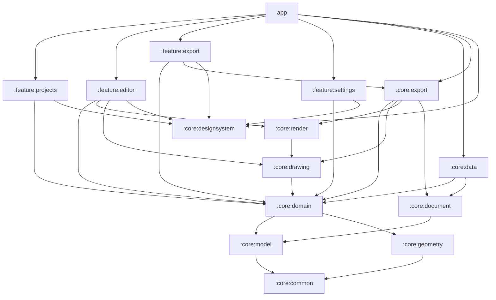
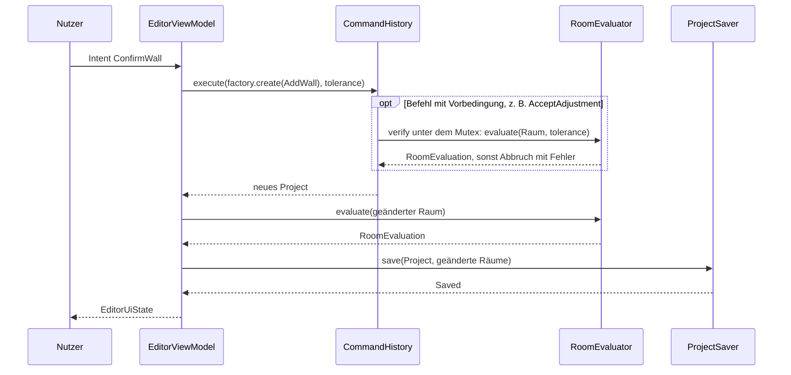
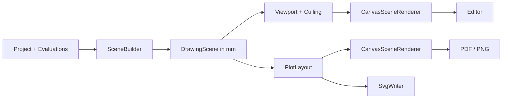

# PlanSnap – Architektur

Bindend für alle Agenten. Entscheidungen sind in `docs/adr/` begründet.

## 1. Überblick

PlanSnap ist eine Offline-Android-App in Kotlin mit Jetpack Compose. Die Fachlogik liegt in reinen JVM-Modulen ohne Android-Abhängigkeit. Die UI folgt einem unidirektionalen Datenfluss: Intents gehen an ein ViewModel, das über Use Cases und Befehle das unveränderliche Modell ändert und einen `StateFlow` mit UI-State liefert. Einmalige Effekte laufen getrennt.

## 2. Module

| Modul | Typ | Verantwortung |
|---|---|---|
| `:core:common` | JVM | `DomainResult`, Fehler, Dispatcher-, Uhr- und ID-Abstraktion, `Length`, `Angle`, Einheiten, Parsen und Formatieren |
| `:core:geometry` | JVM | Vektoren, Polygone, Toleranzen, Traverse, Solver, Ausgleich, Bänder, Metriken |
| `:core:model` | JVM | Unveränderliche Modelle: Projekt, Raum, Wand, Ecke, Diagonale, Öffnung, Platzierung |
| `:core:domain` | JVM | Raumauswertung, Befehle, Historie, Andocken, Einrasten, Flächenbericht, Repository-Schnittstellen |
| `:core:document` | JVM | Versioniertes JSON-Format, Codec, Formatmigrationen |
| `:core:drawing` | JVM | Szene, Viewport, Hit-Testing, Culling, `PlotLayout` |
| `:core:render` | Android | Zeichnen der Szene auf `android.graphics.Canvas` |
| `:core:data` | Android | Room, DataStore, Repository-Implementierungen |
| `:core:export` | Android | PDF, PNG, SVG, JSON hinter `Exporter` |
| `:core:designsystem` | Android | Theme, Tokens, Basiskomponenten |
| `:feature:projects` | Android | Projektliste, Import |
| `:feature:editor` | Android | Messbildschirm, Plan, Öffnungen, Räume |
| `:feature:export` | Android | Exportdialog, Vorprüfung, Teilen und Speichern |
| `:feature:settings` | Android | Einheiten, Toleranzen, Hinweise |
| `:app` | Android | Navigation, DI-Wurzel, Application, App-Theme um den NavHost (über `:core:designsystem`) |
| `:testing:fixtures` | JVM | Generatoren, Fakes, Referenzräume, Golden-Dateien |
| `:benchmark` | Android-Test | Baseline Profile, Start- und Frame-Messung |

### Abhängigkeitsregeln

1. Abhängigkeiten zeigen nur in Richtung des Diagramms. Features hängen nie voneinander ab.
2. Die JVM-Module importieren weder `android.*` noch `androidx.*`.
3. `:core:geometry` hängt nur von `:core:common` ab und kennt keine Domänenmodelle.
4. `:testing:fixtures` darf nur als Testabhängigkeit eingebunden werden.
5. Ein Architekturtest in `build-logic` lässt den Build bei einem Verstoß fehlschlagen.

## 3. Datenfluss

## 4. Zustand

- Das Modell ist unveränderlich und nutzt `kotlinx.collections.immutable`.
- `EditorUiState` ist unveränderlich und enthält das Projekt, Auswertungen, Auswahl, Eingabe und Speicherstatus.
- Effekte (Snackbar, Dialog, Teilen) laufen über einen `Channel`.
- `SavedStateHandle` hält Projekt-ID, Raum-ID, Viewport und Eingabetext. Der Eingabeentwurf liegt zusätzlich in der Datenbank.

## 5. Nebenläufigkeit

| Arbeit | Dispatcher | Regel |
|---|---|---|
| State-Updates | Main | Nur im ViewModel |
| Solver, Raumauswertung | Default | Abbrechbar über `CancellationSignal`. Bei Vorschauen ersetzt ein neuerer Lauf den älteren |
| Szene | Default | `SceneBuilder` ist rein und kennt kein Signal. Abbrechbare Aufrufer bauen raumweise mit `buildRoom` und prüfen den Abbruch zwischen den Aufrufen |
| `CommandHistory` | Default für die Auswertung | Mutex nehmen, unter ihm per `withContext` `verify`, `apply` und Platzierungen rechnen, danach unter demselben Mutex committen. Bestätigte Befehle laufen im Application-Scope und werden nie verworfen. Abbruch vor dem Commit ändert nichts (ADR 0016, ADR 0019) |
| Datenbank, Dateien | IO | `ProjectSaver` arbeitet Schreibvorgänge seriell ab |

Dispatcher werden immer injiziert. `:core:geometry` bleibt frei von Coroutines und sieht nur die JVM-Abstraktion `CancellationSignal`, die `:core:domain` an den laufenden Job bindet. Eine bestätigte Wand gilt erst als gespeichert, wenn die Transaktion abgeschlossen ist. Bestätigte Befehle und `ProjectSaver` laufen im Application-Scope und überleben das ViewModel. Nur Vorschauen und Auswertungen ohne Commit hängen am Bildschirm und sind abbrechbar.

Bedingungen, die eine Auswertung oder die Toleranz brauchen, prüft `ProjectCommand.verify` unter dem Mutex der Historie, nie der Aufrufer vorab (ADR 0019). Der Aufrufer übergibt `execute` die zum Aufrufzeitpunkt gültige Toleranz aus den Einstellungen, Operationen gelten in Aufrufreihenfolge. Undo und Redo prüfen keine Vorbedingung erneut. `reconcile` ändert nur Platzierungen, ein gültig bestätigtes Overlay bleibt bei einem Toleranzwechsel bestehen.

## 6. Fehlerbehandlung

Erwartbare Fachfehler sind Werte vom Typ `DomainResult<T>` mit einer versiegelten `DomainError`-Hierarchie. Die Features übersetzen sie in String-Ressourcen. Exceptions bleiben technischen Fehlern vorbehalten und werden an der Data- oder Export-Grenze in `DomainError` umgewandelt. `CancellationException` wird nie abgefangen.

## 7. Persistenz

Tabellen (siehe ADR 0006):

| Tabelle | Inhalt |
|---|---|
| `projects` | `id`, Name, Zeitstempel, Standardhöhe, Formatversion |
| `rooms` | `id`, `projectId`, Reihenfolge, JSON-Dokument des Raums |
| `editor_drafts` | `projectId`, Raum, laufende Eingabe |

Einstellungen liegen in DataStore. Room-Schemas werden exportiert und versioniert. Das Android-Backup ist deaktiviert.

## 8. Rendering

Welt: x nach rechts, y nach oben, Millimeter. Bildschirm: y nach unten, Pixel. Nur `Viewport` und `PlotLayout` rechnen zwischen beiden um. Szenen werden je Raum gecacht. Hit-Testing und Einrasten arbeiten in Weltkoordinaten.

## 9. Versionen

Am 2026-11-23 gegen Google Maven, Maven Central und das Gradle Plugin Portal ermittelt. Die Kombination wurde in einem Wegwerfprojekt gebaut (Debug, Release mit R8, JVM-Tests, Robolectric, Roborazzi, Kover, detekt, Spotless, Pitest, Baseline-Profile-Modul).

| Komponente | Version | Komponente | Version |
|---|---|---|---|
| Gradle | 9.9.2 | Hilt | 2.60.1 |
| AGP | 9.5.2 | Hilt Navigation Compose | 1.3.0 |
| Kotlin | 2.4.21 | Room | 2.8.5 |
| KSP | 2.3.14 | DataStore | 1.3.0 |
| JDK | 21 (Bytecode 17) | Coroutines | 1.11.0 |
| compileSdk / targetSdk | 36 | Serialization JSON | 1.13.0 |
| minSdk | 26 (`:benchmark` 28) | Immutable Collections | 0.5.2 |
| Compose BOM | 2026.06.01 | JUnit | 6.1.3 |
| Core KTX | 1.18.0 | JUnit 4 | 4.13.2 |
| Activity Compose | 1.13.0 | Kotest Property | 6.2.7 |
| Lifecycle | 2.10.0 | Turbine | 1.2.1 |
| Navigation Compose | 2.9.8 | MockK | 1.14.12 |
| Benchmark / Baseline | 1.5.0 | Robolectric | 4.18.1 |
| Profile Installer | 1.4.1 | Roborazzi | 1.79.0 |
| UIAutomator | 2.4.1 | Kover | 0.9.11 |
| AndroidX Test Runner | 1.7.0 | detekt | 1.23.8 |
| AndroidX Test JUnit | 1.3.0 | Spotless / ktlint | 8.12.0 / 1.8.0 |
| Espresso | 3.7.0 | Pitest Plugin / Pitest | 1.19.0 / 1.30.2 |

AGP 9 enthält die Kotlin-Integration. Das Plugin `org.jetbrains.kotlin.android` wird nicht angewendet. Neuere AndroidX-Stände erfordern compileSdk 37 (ADR 0012). Jede Bibliothek über diese Liste hinaus braucht eine Begründung mit Lizenz und Wartungsstatus.

## 10. Sicherheit und Datenschutz

Das Manifest deklariert weder `INTERNET` noch eine andere gefährliche Berechtigung. Dateien werden über den Dateidialog (SAF) oder `FileProvider` weitergegeben. Es gibt keine Telemetrie. Importdateien gelten als nicht vertrauenswürdig: `:core:data` prüft Größe, Wertebereiche und Formatversion beim Decodieren und danach das Projekt mit `ProjectValidator`, bevor es gespeichert wird (maximal 20 MB, ADR 0017).
