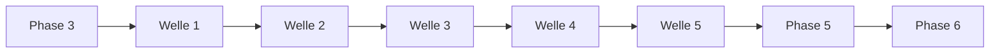

# PlanSnap – Aufgaben und Wellen

**Legende:** `…` steht für `src/{main,test}/kotlin/app/plansnap/<modul>`. Rollen und Modelle: `architect`, `geometry-engineer`, `reviewer` = opus; `feature-engineer`, `ui-engineer`, `test-engineer`, `build-engineer` = sonnet; `boilerplate-engineer` = haiku. Größe L ist nicht zulässig und wird vorab zerlegt.

Innerhalb eines Batches sind Aufgaben unabhängig und laufen parallel, höchstens 4 gleichzeitig. Ein Gate schließt jede Phase und Welle ab. Ausnahme vom Ein-Besitzer-Prinzip über Batches: Eine spätere Aufgabe darf einen Pfad übernehmen, nachdem die frühere gemergt ist.

## Übersicht

| Batch | Aufgaben |
|---|---|
| Phase 3 / F.1 | T-BLD-001 |
| Phase 3 / F.2 | T-BLD-002, T-BLD-003, T-ARC-001, T-ARC-002 |
| Phase 3 / F.3 | T-ARC-003, T-BLD-004 |
| Phase 3 / F.4 (Review-Fixes) | T-ARC-004, T-BLD-005 |
| Phase 3 / F.5 (Review-Fixes) | T-ARC-005 |
| Phase 3 / F.6 (Nachreview-Fixes) | T-ARC-006, T-BLD-006 |
| Phase 3 / F.7 (Review-Fixes) | T-ARC-007 |
| Phase 3 / F.8 (Review-Fixes) | T-ARC-008 |
| Phase 3 / F.9 (Review-Fixes) | T-ARC-009 |
| Welle 1 / 1.1 | T-COM-001, T-GEO-001, T-DES-001, T-DOC-001 |
| Welle 1 / 1.2 | T-GEO-002, T-GEO-003, T-DAT-001, T-DAT-003 |
| Welle 1 / 1.3 | T-GEO-004, T-GEO-006, T-DAT-002, T-GEO-008 (Fix) |
| Welle 1 / 1.4 | T-GEO-005, T-GEO-007, T-DAT-004 (Fix aus Gate-Review) |
| Welle 2 / 2.1 | T-DOM-001, T-DOM-002, T-DOM-005, T-DRW-002 |
| Welle 2 / 2.2 | T-DOM-003, T-DOM-004, T-DOM-006, T-DRW-001, T-GEO-009 (Fix) |
| Welle 2 / 2.3 | T-RND-001, T-EXP-001, T-APP-001, T-DOM-007 |
| Welle 2 / 2.4 (Gate-Fix) | CR-W2-06 |
| Welle 3 / 3.1 | T-EDT-001, T-PRJ-001, T-SET-001, T-EXP-002 |
| Welle 3 / 3.2 | T-EDT-002, T-EDT-003, T-EXP-003 |
| Welle 3 / 3.3 | T-EDT-004, T-FEX-001 |
| Welle 4 / 4.1 | T-EDT-005, T-EDT-006, T-EDT-007, T-EDT-008 |
| Welle 4 / 4.2 | T-EDT-009, T-UX-001 |
| Welle 5 / 5.1 | T-A11-001, T-L10-001, T-UX-002, T-PRF-001 |
| Phase 5 / H.1 | T-E2E-001, T-SEC-001 |
| Phase 5 / H.2 | T-E2E-002 |
| Phase 5 / H.3 | T-PRF-002 |
| Phase 5 / H.4 | T-REV-001 |
| Phase 6 / R.1 | T-REL-001, T-REL-002, T-REL-003 |
| Phase 6 / R.2 | T-REL-004 |

## Phase 3

### Batch F.1

#### T-BLD-001 – Projektgerüst mit allen Modulen

- **Modul:** :*
- **Rolle/Modell:** build-engineer
- **Größe:** M
- **Abhängigkeiten:** keine
- **Besitzbereich:** `settings.gradle.kts`, `build.gradle.kts`, `gradle/`, `gradle.properties`, `build-logic/`, `app/`, `core/`, `feature/`, `testing/`, `benchmark/`
- **Vertrag:** Modulgraph und Versionen aus ARCHITECTURE §2 und §9
- **Akzeptanzkriterien:** `./gradlew assembleDebug` ist grün, Namespace `app.plansnap`, minSdk 26, compileSdk und targetSdk 36. Anforderungen: REQ-NFR-004
- **Tests:** Build-Smoke, Prüfung der Manifest-Berechtigungen

### Batch F.2

#### T-BLD-002 – Qualitätswerkzeuge und Architekturtest

- **Modul:** build-logic
- **Rolle/Modell:** build-engineer
- **Größe:** M
- **Abhängigkeiten:** T-BLD-001
- **Besitzbereich:** `build-logic/`, `config/`, `gradle/libs.versions.toml`
- **Vertrag:** Regeln aus ARCHITECTURE §2
- **Akzeptanzkriterien:** Spotless, detekt, Lint, Kover und Pitest sind aktiv. Eine verbotene Abhängigkeit oder ein `android.*`-Import in JVM-Modulen lässt den Build fehlschlagen. Anforderungen: REQ-NFR-006, REQ-NFR-004
- **Tests:** Negativtests des Architekturchecks

#### T-BLD-003 – GitHub-Actions-Pipeline

- **Modul:** .github
- **Rolle/Modell:** build-engineer
- **Größe:** S
- **Abhängigkeiten:** T-BLD-001
- **Besitzbereich:** `.github/`
- **Vertrag:** Taktung aus WORKFLOWS §3
- **Akzeptanzkriterien:** CI führt Build, Tests, Lint und Kover aus. Ein Emulator-Job führt instrumentierte Tests aus. Dependabot schließt AndroidX-Updates mit compileSdk 37 aus. Anforderungen: REQ-NFR-006
- **Tests:** YAML-Validierung, erster CI-Lauf nach Push

#### T-ARC-001 – Verträge: common, geometry, model

- **Modul:** core/common, core/geometry, core/model
- **Rolle/Modell:** architect
- **Größe:** M
- **Abhängigkeiten:** T-BLD-001
- **Besitzbereich:** `core/common/`, `core/geometry/`, `core/model/`
- **Vertrag:** DOMAIN §1 bis §10
- **Akzeptanzkriterien:** Alle öffentlichen Typen und Signaturen existieren mit KDoc und kompilieren. Anforderungen: REQ-NFR-003
- **Tests:** Tests für Wertetypen und Invarianten

#### T-ARC-002 – Verträge: domain, document, drawing, export

- **Modul:** core/domain, core/document, core/drawing, core/export
- **Rolle/Modell:** architect
- **Größe:** M
- **Abhängigkeiten:** T-BLD-001
- **Besitzbereich:** `core/domain/`, `core/document/`, `core/drawing/`, `core/export/`
- **Vertrag:** ARCHITECTURE §2 bis §8, DOMAIN §4 und §11
- **Akzeptanzkriterien:** `RoomEvaluator`, `ProjectCommand`, `CommandHistory`, Repository-Schnittstellen, `DocumentCodec`, `DrawingScene` und `Exporter` kompilieren mit KDoc. Anforderungen: REQ-NFR-003
- **Tests:** Kompilierung, Vertragstests der Fakes

### Batch F.3

#### T-ARC-003 – Fixtures und Fakes

- **Modul:** testing/fixtures
- **Rolle/Modell:** test-engineer
- **Größe:** M
- **Abhängigkeiten:** T-ARC-001, T-ARC-002
- **Besitzbereich:** `testing/fixtures/`
- **Vertrag:** Verträge aus T-ARC-001 und T-ARC-002
- **Akzeptanzkriterien:** Referenzräume aus TESTING §3, Generatoren mit Seed, Fakes für alle Repositories. Anforderungen: REQ-NFR-006
- **Tests:** Selbsttests der Generatoren

#### T-BLD-004 – Emulator-Weg aus WSL verifizieren

- **Modul:** scripts
- **Rolle/Modell:** build-engineer
- **Größe:** S
- **Abhängigkeiten:** T-BLD-001
- **Besitzbereich:** `scripts/`
- **Vertrag:** WORKFLOWS §2
- **Akzeptanzkriterien:** Ein Skript baut, installiert und startet einen instrumentierten Beispieltest über `adb.exe` und meldet den Exit-Code korrekt. Anforderungen: REQ-NFR-005
- **Tests:** Echter Lauf auf dem Windows-Emulator

### Batch F.4

#### T-ARC-004 – Vertragskorrekturen aus dem Phase-3-Review

- **Modul:** core/*, testing/fixtures
- **Rolle/Modell:** architect
- **Größe:** M
- **Abhängigkeiten:** T-ARC-001, T-ARC-002, T-ARC-003
- **Besitzbereich:** `core/common/`, `core/geometry/`, `core/model/`, `core/domain/`, `core/document/`, `core/drawing/`, `core/export/`, `testing/fixtures/` (nur zur Anpassung an Signaturen), `docs/DOMAIN.md`, `docs/ARCHITECTURE.md`, `docs/adr/`
- **Vertrag:** Review-Befunde H1 bis H6, M1 bis M7, N1
- **Akzeptanzkriterien:** Jeder Befund ist behoben und durch Test oder Vertragstext belegt. Anforderungen: REQ-NFR-003, REQ-EXP-002, REQ-UX-004, REQ-DATA-004, REQ-MOD-011, REQ-MEAS-004
- **Tests:** Tests für neue Invarianten und Wertetypen

#### T-BLD-005 – Screenshot-Infrastruktur

- **Modul:** build-logic
- **Rolle/Modell:** build-engineer
- **Größe:** S
- **Abhängigkeiten:** T-BLD-002
- **Besitzbereich:** `build-logic/`, `gradle/libs.versions.toml`, `config/lint/`, `.github/`, `core/designsystem/`
- **Vertrag:** WORKFLOWS §3, ADR 0010
- **Akzeptanzkriterien:** Ein Beispiel-Screenshot wird aufgezeichnet, `verifyRoborazziDebug` ist grün und schlägt bei einer Bildänderung fehl. CI führt die Prüfung aus und lädt Diff-Bilder hoch. Anforderungen: REQ-NFR-006
- **Tests:** Echter Positiv- und Negativlauf

### Batch F.5

#### T-ARC-005 – Fakes vertragstreu machen

- **Modul:** testing/fixtures
- **Rolle/Modell:** test-engineer
- **Größe:** S
- **Abhängigkeiten:** T-ARC-004
- **Besitzbereich:** `testing/fixtures/`
- **Vertrag:** Review-Befunde M8 und M9
- **Akzeptanzkriterien:** Der Fake speichert nur gemeldete Raumänderungen und löscht beim Projektlöschen auch den Entwurf. Anforderungen: REQ-NFR-006
- **Tests:** Negativtests für nicht gemeldete Änderungen

### Batch F.6

#### T-ARC-006 – Überbestimmte Räume und Nebenläufigkeit präzisieren

- **Modul:** core/geometry, core/domain, testing/fixtures
- **Rolle/Modell:** architect
- **Größe:** M
- **Abhängigkeiten:** T-ARC-004, T-ARC-005
- **Besitzbereich:** `core/common/`, `core/geometry/`, `core/model/`, `core/domain/`, `core/drawing/`, `testing/fixtures/`, `docs/DOMAIN.md`, `docs/ARCHITECTURE.md`, `docs/adr/`
- **Vertrag:** Nachreview-Befunde NH1 bis NH3, NM1 bis NM4, NM6, NN1
- **Akzeptanzkriterien:** Unbestimmte Räume werden nie als bestätigt ausgewiesen. `CONFLICT(MEASUREMENTS_INCONSISTENT)` folgt genau bei `S > T` und `q² > χ²(r; 0,99)`. Eine ausdrückliche Bestätigung ist genau bei `S > T` und `χ²(r; 0,95) < q² ≤ χ²(r; 0,99)` nötig. Wandfehler ab 3 T werden bei kontrollierbaren Messungen (`λ(3T) ≥ λ₀(r)`) zu mindestens 95 % erkannt. Nicht kontrollierbare Messungen weist das Ergebnis samt empfohlenem Zusatzmaß aus. Stimmige Zusatzmaße verschlechtern den Status nicht. Die Regeln sind an den Zahlenfällen des Reviews nachgerechnet. Anforderungen: REQ-MEAS-008, REQ-MEAS-009, REQ-MEAS-011, REQ-DATA-002
- **Tests:** Vertragstests, Referenzfälle als Fixtures für T-GEO-005 und T-GEO-006

#### T-BLD-006 – Robolectric-Konvention für Nicht-Compose-Module

- **Modul:** build-logic
- **Rolle/Modell:** build-engineer
- **Größe:** S
- **Abhängigkeiten:** T-BLD-005
- **Besitzbereich:** `build-logic/`, `gradle/libs.versions.toml`, `core/render/build.gradle.kts`, `core/data/build.gradle.kts`, `core/export/build.gradle.kts`
- **Vertrag:** Nachreview-Befund NM5
- **Akzeptanzkriterien:** `:core:render` hat Robolectric und `verifyRoborazziDebug`, `:core:data` und `:core:export` haben Robolectric im Testklassenpfad. Anforderungen: REQ-NFR-006
- **Tests:** Je Modul ein temporärer echter Robolectric-Lauf, für `:core:render` zusätzlich Positiv- und Negativlauf

### Batch F.7

#### T-ARC-007 – Entscheidungsablauf der Raumauswertung absichern

- **Modul:** core/geometry, core/domain, testing/fixtures
- **Rolle/Modell:** architect
- **Größe:** M
- **Abhängigkeiten:** T-ARC-006
- **Besitzbereich:** `core/geometry/`, `core/domain/`, `testing/fixtures/`, `docs/DOMAIN.md`, `docs/adr/`
- **Vertrag:** Befunde H1 bis H3, M1, M2 und N1 des dritten Reviews
- **Akzeptanzkriterien:** Selbstüberschneidende Räume werden nie `CONFIRMED`. Rundung in stimmigen Maßen führt nicht zu `CONFLICT`. Eine Drehrichtung gilt erst bei `d·τ < −2°` als verletzt, `α = 180°` hat keine Richtung. Eine systematische Zufallsprüfung des Ablaufs gegen bekannte Wahrheit ist dokumentiert. Anforderungen: REQ-MEAS-006, REQ-MEAS-008, REQ-MEAS-009, REQ-MEAS-011
- **Tests:** Zahlenfälle des Reviews als Referenzfälle, Vertragstests

### Batch F.8

#### T-ARC-008 – Mehrdeutige Formen und Prüfstand

- **Modul:** core/geometry, core/domain, testing/fixtures
- **Rolle/Modell:** architect
- **Größe:** S
- **Abhängigkeiten:** T-ARC-007
- **Besitzbereich:** `core/geometry/`, `core/domain/`, `testing/fixtures/`, `docs/DOMAIN.md`, `docs/adr/`, `docs/research/`
- **Vertrag:** Entscheidung zu diskret mehrdeutigen Formen
- **Akzeptanzkriterien:** Findet der Solver bei `missing = 0` eine zweite gültige Form mit mehr als `T` Abweichung, folgt `PROPOSED` mit Grund und empfohlenem Zusatzmaß. Der Prüfstand liegt versioniert im Repository. Anforderungen: REQ-MEAS-006, REQ-MEAS-008
- **Tests:** Vertragstests und Referenzfälle

### Batch F.9

#### T-ARC-009 – Vorbedingungen unter dem Historien-Mutex

- **Modul:** core/geometry, core/domain
- **Rolle/Modell:** architect
- **Größe:** S
- **Abhängigkeiten:** T-ARC-008
- **Besitzbereich:** `core/geometry/`, `core/domain/`, `testing/fixtures/` (nur Anpassung), `docs/DOMAIN.md`, `docs/ARCHITECTURE.md`, `docs/adr/`
- **Vertrag:** Abschlussreview H1 und M1
- **Akzeptanzkriterien:** Ein Befehl kann eine `suspend`-Vorbedingung haben, die `CommandHistory.execute` unter dem Mutex mit der aktuellen Toleranz vor dem Commit prüft. `apply` bleibt rein. `AcceptAdjustment` nutzt sie, ein veralteter Vorschlag wird abgelehnt. `ClosureTolerance` erzwingt `T > 0`. Anforderungen: REQ-MEAS-008, REQ-MEAS-009, REQ-MEAS-011
- **Tests:** Vertragstests für Invariante und Vorbedingung

## Welle 1

### Batch 1.1

#### T-COM-001 – Einheiten, Parsen, Formatieren

- **Modul:** core/common
- **Rolle/Modell:** boilerplate-engineer
- **Größe:** S
- **Abhängigkeiten:** T-ARC-001
- **Besitzbereich:** `core/common/…/units/`
- **Vertrag:** `LengthParser` (mit Parameter `field`), `AngleParser` (vorhandene `DecimalAngleParser` wiederverwenden), `LengthFormatter`, `AngleFormatter`
- **Akzeptanzkriterien:** `345` cm, `3,45` m und `3450` mm ergeben 3450 mm. Komma und Punkt werden akzeptiert, Überlauf wird abgelehnt. Anforderungen: REQ-MEAS-002, REQ-NFR-003
- **Tests:** Tabellentests, Roundtrip-Property

#### T-GEO-001 – Primitiven, Toleranzen, Polygone

- **Modul:** :core:geometry
- **Rolle/Modell:** geometry-engineer
- **Größe:** M
- **Abhängigkeiten:** T-ARC-001
- **Besitzbereich:** `core/geometry/…/primitives/`, `core/geometry/…/polygon/`
- **Vertrag:** DOMAIN §1 und §7
- **Akzeptanzkriterien:** Schnittest, Einfachheit, Orientierung und Shoelace erfüllen die Referenzfälle. Anforderungen: REQ-MOD-009
- **Tests:** Analytisch, Rotation- und Translation-Property

#### T-DES-001 – Design-System

- **Modul:** :core:designsystem
- **Rolle/Modell:** ui-engineer
- **Größe:** M
- **Abhängigkeiten:** T-BLD-001
- **Besitzbereich:** `core/designsystem/`
- **Vertrag:** UX §6
- **Akzeptanzkriterien:** Theme hell und dunkel ohne Dynamic Color, Tokens und Basiskomponenten. Kontrast ist WCAG AA, Touch-Ziele mindestens 48 dp. Anforderungen: REQ-UX-007, REQ-UX-008
- **Tests:** Kontrasttest, Roborazzi

#### T-DOC-001 – Versioniertes JSON-Format

- **Modul:** :core:document
- **Rolle/Modell:** feature-engineer
- **Größe:** M
- **Abhängigkeiten:** T-ARC-002
- **Besitzbereich:** `core/document/`
- **Vertrag:** ADR 0006, `DocumentCodec`
- **Akzeptanzkriterien:** Roundtrip ist verlustfrei inklusive Rohwerten und Overlay. Neuere Hauptversion, ungültige Werte und zu große Dateien werden abgelehnt. Anforderungen: REQ-DATA-004, REQ-MEAS-010
- **Tests:** Golden, Property, Fuzz

### Batch 1.2

#### T-GEO-002 – Traverse und Schließungsfehler

- **Modul:** :core:geometry
- **Rolle/Modell:** geometry-engineer
- **Größe:** M
- **Abhängigkeiten:** T-GEO-001
- **Besitzbereich:** `core/geometry/…/traverse/`
- **Vertrag:** DOMAIN §3 und §4
- **Akzeptanzkriterien:** 90°- und Winkelzug korrekt, Lücke und Grenzwert `T` korrekt inklusive Grenzfällen. Trigonometrie und Wurzeln nutzen durchgehend `StrictMath`, damit Auswertungen bitgleich reproduzierbar sind (DOMAIN §11, ADR 0019). Anforderungen: REQ-MEAS-003, REQ-MEAS-004, REQ-MEAS-011
- **Tests:** Analytisch, Property

#### T-GEO-003 – Wandbänder

- **Modul:** :core:geometry
- **Rolle/Modell:** geometry-engineer
- **Größe:** M
- **Abhängigkeiten:** T-GEO-001
- **Besitzbereich:** `core/geometry/…/bands/`
- **Vertrag:** DOMAIN §8
- **Akzeptanzkriterien:** Gehrung, Fase, konkave und kollineare Ecken korrekt. Stärke ändert die Fläche nicht. Anforderungen: REQ-MEAS-012, REQ-MEAS-013
- **Tests:** Referenzecken, Property

#### T-DAT-001 – Room-Datenbank

- **Modul:** :core:data
- **Rolle/Modell:** feature-engineer
- **Größe:** M
- **Abhängigkeiten:** T-DOC-001
- **Besitzbereich:** `core/data/…/db/`, `core/data/schemas/`
- **Vertrag:** ARCHITECTURE §7
- **Akzeptanzkriterien:** Tabellen, DAOs und exportiertes Schema. Migrationsgerüst ist getestet. Änderungen je Raum sind atomar. Anforderungen: REQ-DATA-002, REQ-DATA-005
- **Tests:** Robolectric-DAO-Tests, Migrationstest-Harness

#### T-DAT-003 – Einstellungen in DataStore

- **Modul:** :core:data
- **Rolle/Modell:** feature-engineer
- **Größe:** S
- **Abhängigkeiten:** T-ARC-002
- **Besitzbereich:** `core/data/…/settings/`
- **Vertrag:** `SettingsRepository`
- **Akzeptanzkriterien:** Einheit, Toleranz, Raster, Stärke und Hinweise werden gespeichert. Ungültige Werte fallen auf den Standard zurück. Ein gespeichertes `absoluteMm < 1` gilt als ungültig und fällt auf den Standard zurück, ohne Absturz (mit Test). Anforderungen: REQ-MEAS-011, REQ-UX-006
- **Tests:** Repository-Tests mit Turbine

### Batch 1.3

#### T-GEO-004 – Constraint-Solver

- **Modul:** :core:geometry
- **Rolle/Modell:** geometry-engineer
- **Größe:** M
- **Abhängigkeiten:** T-GEO-002
- **Besitzbereich:** `core/geometry/…/solver/`
- **Vertrag:** DOMAIN §5.1 bis §5.3, ADR 0004
- **Akzeptanzkriterien:** 3 × 3 × 3 × 5 m ergibt ≈ 70,53°/109,47° und 11,314 m², mit Diagonale 4 m ergibt sich 10,472 m². Ergebnisse sind bitgenau reproduzierbar, harte Maße bleiben erhalten. Anforderungen: REQ-MEAS-005, REQ-MEAS-006, REQ-MEAS-007
- **Tests:** Analytisch, Property, Fuzz

#### T-GEO-006 – Schließungsausgleich

- **Modul:** :core:geometry
- **Rolle/Modell:** geometry-engineer
- **Größe:** M
- **Abhängigkeiten:** T-GEO-002
- **Besitzbereich:** `core/geometry/…/adjustment/`
- **Vertrag:** DOMAIN §6, ADR 0005
- **Akzeptanzkriterien:** Nach dem Ausgleich ist die Lücke höchstens 0,01 mm. Rohwerte bleiben unverändert. Beide `AdjustmentMode`-Pfade sind umgesetzt (ADR 0018). Die Konvergenz im Modus `SHAPE_DEVIATION` ist am Trapez 3/3/3/5 m mit zwei Diagonalen nachgewiesen. Alle Fälle aus `OverdeterminedCases` sind am echten Code bestätigt, einschließlich `startTurnsRad`, Einfachheit und Drehrichtungen nach dem Ausgleich. Die Simulationswerte aus ADR 0018 sind am Produktionscode nachgerechnet. Alle Katalogfälle aus `OverdeterminedCases` und `OverdeterminedRooms` bestehen am Produktionscode. Der Katalog umfasst 30 Fälle. Trigonometrie und Wurzeln nutzen durchgehend `StrictMath`, damit Auswertungen bitgleich reproduzierbar sind (DOMAIN §11, ADR 0019). Anforderungen: REQ-MEAS-009, REQ-MEAS-010
- **Tests:** Analytisch, Property

#### T-DAT-002 – Repositories und ProjectSaver

- **Modul:** :core:data
- **Rolle/Modell:** feature-engineer
- **Größe:** M
- **Abhängigkeiten:** T-DAT-001
- **Besitzbereich:** `core/data/…/repository/`
- **Vertrag:** Repository-Schnittstellen
- **Akzeptanzkriterien:** Anlegen, Lesen, Umbenennen, Löschen und tiefes Duplizieren. Serielles Speichern, Entwurf übersteht Neustart. Anforderungen: REQ-DATA-001, REQ-DATA-002, REQ-DATA-007
- **Tests:** Integration mit Robolectric

#### T-GEO-008 – Fix: Konvergenznorm der Winkelsummenzeile

- **Modul:** :core:geometry
- **Rolle/Modell:** geometry-engineer
- **Größe:** S
- **Abhängigkeiten:** T-GEO-006, CR-W1-01
- **Besitzbereich:** `core/geometry/…/adjustment/` (ohne die Vertragsdatei `ClosureAdjuster.kt`)
- **Vertrag:** DOMAIN §6 nach CR-W1-01
- **Akzeptanzkriterien:** `AdjustmentProblem.residual()` misst die Winkelsummenzeile als Bogen `|c_τ| · U/(2π)` in mm, wie in DOMAIN §6 festgelegt. Die Norm wird vor jedem Schritt geprüft, auch an `x_1`. Regressionstest (WORKFLOWS §6): Rechteck 4000/3000/4000/3000, alle Ecken gemessen, `V_0` = 89 700 mdeg, die übrigen 90 000 mdeg, Modus `MEASUREMENT_ERROR`, Start bei den Sollwinkeln. Vor dem Fix endet der Ausgleich ohne Schritt mit `S = 0` und einer Winkelsumme von 360,3°, danach liegt die Winkelsumme im Rahmen der Norm und `S > 0`. Katalog-, Property- und Simulationstests bleiben grün. KDoc von `DefaultClosureAdjuster` angepasst. Anforderungen: REQ-MEAS-009, REQ-MEAS-010
- **Tests:** Regressionstest, bestehende Suite

### Batch 1.4

#### T-GEO-005 – Bestimmtheit und Empfehlung

- **Modul:** :core:geometry
- **Rolle/Modell:** geometry-engineer
- **Größe:** M
- **Abhängigkeiten:** T-GEO-004
- **Besitzbereich:** `core/geometry/…/determinacy/`
- **Vertrag:** DOMAIN §5.4 und §5.5
- **Akzeptanzkriterien:** `analyzeConstraints` ist umgesetzt, `missing = v − ρ_J` stimmt, die empfohlene Diagonale erhöht den Rang, Überbestimmung wird ohne vorherige Lösung erkannt (ADR 0018). Alle Fälle aus `OverdeterminedCases` sind geprüft, ebenso `analyze` und `analyzeControl` mit den Signaturen aus T-ARC-006. Der Prüfstand aus `docs/research/` ist als seeded Test am Produktionscode portiert, mit `SOLVER_GRADIENT = 1e-9`. Stimmige ehrliche Räume, falsche Richtungen, unterbestimmte Räume und Grenzwerte haben 0 falsche Bestätigungen. Falsche `CONFLICT` liegen je Klasse bei höchstens 1 %. Maßgeblich sind DOMAIN §5.6 und die Sollwerte in `docs/research/evaluation-prototype/README.md`. Trigonometrie und Wurzeln nutzen durchgehend `StrictMath`, damit Auswertungen bitgleich reproduzierbar sind (DOMAIN §11, ADR 0019). Anforderungen: REQ-MEAS-008
- **Tests:** Analytisch, Property

#### T-GEO-007 – Referenz-Suite und Mutationstests

- **Modul:** :core:geometry
- **Rolle/Modell:** test-engineer
- **Größe:** M
- **Abhängigkeiten:** T-GEO-003, T-GEO-004, T-GEO-006
- **Besitzbereich:** `core/geometry/src/test/kotlin/app/plansnap/core/geometry/reference/`
- **Vertrag:** TESTING §3
- **Akzeptanzkriterien:** Alle Referenzformen sind grün, Abdeckung ≥ 90/85 %, Pitest ≥ 70 %. Anforderungen: REQ-MOD-004, REQ-MOD-009, REQ-NFR-006
- **Tests:** Referenzfälle, Pitest

#### T-DAT-004 – Fix: Standardhöhe ganzzahlig speichern

- **Modul:** :core:data
- **Rolle/Modell:** feature-engineer
- **Größe:** S
- **Abhängigkeiten:** T-DAT-002
- **Besitzbereich:** `core/data/…/db/`, `core/data/…/repository/`, `core/data/schemas/`
- **Vertrag:** ADR 0002 (ganzzahlige Rohlängen), `ProjectRepository`
- **Akzeptanzkriterien:** `projects.defaultHeightMm` ist `Long` (INTEGER), ebenso `ProjectMetadataUpdate.defaultHeightMm`. Es gibt keine Umwandlung über `Double` mehr. Schema bleibt Version 1, weil es noch nicht ausgeliefert ist, und `1.json` wird neu erzeugt. Regressionstest (WORKFLOWS §6): `createProject` und `getProject` mit `defaultHeight = 2^53 + 1` mm liefern den Wert exakt zurück, ebenso ein Roundtrip über `ProjectSaver`. Anforderungen: REQ-DATA-004
- **Tests:** Regressionstest, bestehende Suite

## Welle 2

### Batch 2.1

#### T-DOM-001 – RoomEvaluator

- **Modul:** :core:domain
- **Rolle/Modell:** geometry-engineer
- **Größe:** M
- **Abhängigkeiten:** T-GEO-005, T-GEO-006
- **Besitzbereich:** `core/domain/…/evaluation/`
- **Vertrag:** DOMAIN §4
- **Akzeptanzkriterien:** Alle Status und Grenzfälle korrekt. Overlay wird über den Fingerprint validiert. Ein gespeichertes Overlay mit passendem Fingerabdruck wird vor der Neuberechnung geprüft (NM3, mit Test). Anforderungen: REQ-MEAS-006, REQ-MEAS-008, REQ-MEAS-009, REQ-MEAS-010, REQ-MEAS-011
- **Tests:** Zustandstabelle, Property

#### T-DOM-002 – Befehle und Historie

- **Modul:** :core:domain
- **Rolle/Modell:** feature-engineer
- **Größe:** M
- **Abhängigkeiten:** T-ARC-002
- **Besitzbereich:** `core/domain/…/command/`
- **Vertrag:** DOMAIN §11, ADR 0007, ADR 0016, ADR 0019
- **Akzeptanzkriterien:** Jeder Befehl ist rein. Fehlschlag ändert nichts, Undo und Redo sind Identitäten. `EXPLICIT_CONFIRMATION_REQUIRED`, der Mutex-Ablauf mit Commit nach `withContext` und das Verhalten bei Abbruch sind getestet (ADR 0016). `AcceptAdjustment` wird mit `ADJUSTMENT_NOT_AVAILABLE` abgelehnt, wenn die aktuelle Auswertung nicht `NeedsAdjustment` mit gleichem Vorschlag ist (mit Test). `execute` ruft `verify` vor `apply` unter dem Mutex auf, ein Abbruch in `verify` ändert nichts, und der Zahlenfall aus ADR 0019 (Rechteck 4150/3000/4000/3000) wird mit `ADJUSTMENT_NOT_AVAILABLE` abgelehnt (mit Tests). Anforderungen: REQ-UX-005, REQ-MEAS-010
- **Tests:** Property mit zufälligen Befehlsfolgen

#### T-DOM-005 – Flächenbericht

- **Modul:** :core:domain
- **Rolle/Modell:** feature-engineer
- **Größe:** S
- **Abhängigkeiten:** T-GEO-001
- **Besitzbereich:** `core/domain/…/report/`
- **Vertrag:** DOMAIN §7
- **Akzeptanzkriterien:** Fläche, Umfang, Volumen, Faktor und Summen stimmen. Höhe nutzt den Raum- oder Standardwert. Anforderungen: REQ-MOD-005, REQ-MOD-009, REQ-MOD-010
- **Tests:** Tabellentests

#### T-DRW-002 – Viewport und Hit-Testing

- **Modul:** :core:drawing
- **Rolle/Modell:** geometry-engineer
- **Größe:** M
- **Abhängigkeiten:** T-ARC-002
- **Besitzbereich:** `core/drawing/…/viewport/`, `core/drawing/…/hit/`
- **Vertrag:** ADR 0008
- **Akzeptanzkriterien:** Transformationen sind invers, Zoom bleibt um den Fokuspunkt stabil, Treffer folgen der Prioritätsregel. Anforderungen: REQ-UX-003
- **Tests:** Property, Tabellentests

#### T-GEO-009 – Fix: Drehrichtung an der Schlussecke in der Solver-Auswahl

- **Modul:** :core:geometry
- **Rolle/Modell:** geometry-engineer
- **Größe:** S
- **Abhängigkeiten:** T-GEO-004, T-DOM-001
- **Besitzbereich:** `core/geometry/…/solver/`
- **Vertrag:** DOMAIN §3, §5.3, §5.6
- **Akzeptanzkriterien:** Zuerst reproduzieren (WORKFLOWS §6). Prüfen, ob `SolverProblem.violatesDirections` bei deklarierter Schlussecke die tatsächlich entstehende Drehung an `V_0` übersieht, weil es `τ̂_0` statt des abgeleiteten `τ_0` prüft (Hinweis aus T-DOM-001). Bestätigt sich der Fehler, prüft die Auswahl nach §5.3 und der Alternativenfilter nach §5.6 die abgeleitete Drehung, mit Regressionstest. Bestätigt er sich nicht, wird der Nachweis als Test festgehalten. Katalog, Prüfstand und Referenz-Suite bleiben grün. Anforderungen: REQ-MEAS-005, REQ-MEAS-007
- **Tests:** Regressionstest, bestehende Suite

### Batch 2.2

#### T-DOM-003 – Öffnungsregeln

- **Modul:** :core:domain
- **Rolle/Modell:** feature-engineer
- **Größe:** M
- **Abhängigkeiten:** T-DOM-002
- **Besitzbereich:** `core/domain/…/opening/`
- **Vertrag:** DOMAIN §9
- **Akzeptanzkriterien:** Grenzen und Überlappung geprüft, optionale Felder korrekt. Bei gekürzter Wand bleibt die Öffnung erhalten und wird `OUT_OF_BOUNDS`. Anforderungen: REQ-MOD-001, REQ-MOD-002, REQ-MOD-003
- **Tests:** Tabellentests, Property

#### T-DOM-004 – Platzierung und Andocken

- **Modul:** :core:domain
- **Rolle/Modell:** geometry-engineer
- **Größe:** M
- **Abhängigkeiten:** T-DOM-002
- **Besitzbereich:** `core/domain/…/placement/`
- **Vertrag:** DOMAIN §10, ADR 0013
- **Akzeptanzkriterien:** Abstand entspricht exakt der Wandstärke, Zyklen werden abgelehnt, freies Bewegen erhält Maße, 30 Räume sind möglich. Anforderungen: REQ-MOD-006, REQ-MOD-007, REQ-MOD-008
- **Tests:** Analytisch, Property

#### T-DOM-006 – Einrasten

- **Modul:** :core:domain
- **Rolle/Modell:** feature-engineer
- **Größe:** S
- **Abhängigkeiten:** T-GEO-001
- **Besitzbereich:** `core/domain/…/snap/`
- **Vertrag:** DOMAIN §10
- **Akzeptanzkriterien:** Priorität Ecke, Wand, Raster stimmt. Abschalten liefert die Eingabe unverändert. Anforderungen: REQ-UX-010
- **Tests:** Tabellentests

#### T-DRW-001 – SceneBuilder

- **Modul:** :core:drawing
- **Rolle/Modell:** feature-engineer
- **Größe:** M
- **Abhängigkeiten:** T-DOM-001, T-GEO-003
- **Besitzbereich:** `core/drawing/…/scene/`
- **Vertrag:** ADR 0008
- **Akzeptanzkriterien:** Wände, Öffnungen, Maßketten und Beschriftungen vollständig. Unbestätigte Räume tragen die Kennzeichnung. Anforderungen: REQ-UX-004, REQ-EXP-006
- **Tests:** JVM-Golden

### Batch 2.3

#### T-DOM-007 – Projektvalidierung

- **Modul:** :core:domain
- **Rolle/Modell:** feature-engineer
- **Größe:** S
- **Abhängigkeiten:** T-DOM-003, T-DOM-004
- **Besitzbereich:** `core/domain/…/validation/` (nur neue Implementierungsdateien, der Vertrag in `ProjectRules.kt` bleibt eingefroren)
- **Vertrag:** `ProjectValidator`, DOMAIN §9 bis §11
- **Akzeptanzkriterien:** Grenzwerte aus `GeometryTolerances`, Andockziele einschließlich `DockLink.ownWallId`, Wirtsöffnungen auf ihrer Wand, Andockzyklen und überlappende Öffnungen je Wand werden erkannt. Sich berührende Öffnungen gelten nicht als Überlappung. Gemeldet wird der erste Verstoß in Raum- und Indexreihenfolge. Die Regeln aus T-DOM-003 und T-DOM-004 werden wiederverwendet, nicht dupliziert. Zusätzlich ein Integrationstest des Zahlenfalls aus ADR 0019 (Rechteck 4150/3000/4000/3000) über `DefaultCommandHistory` mit `DefaultRoomEvaluator`. `RoomProjectRepository` (T-DAT-002) erhält die Implementierung über T-APP-001. Anforderungen: REQ-DATA-004, REQ-NFR-003
- **Tests:** Tabellentests je Regel, Property: gültige Generatorprojekte bestehen

#### T-RND-001 – Canvas-Renderer

- **Modul:** :core:render
- **Rolle/Modell:** ui-engineer
- **Größe:** M
- **Abhängigkeiten:** T-DRW-001
- **Besitzbereich:** `core/render/`
- **Vertrag:** ADR 0008
- **Akzeptanzkriterien:** Alle Szenenelemente werden gezeichnet, ohne Allokationen pro Element im Zeichenpfad. Jeder `SceneStyle` hat eine Darstellung: `ROOM_BODY*` getönt gefüllt mit Umriss, `_UNCONFIRMED` gestrichelt. Eckmarker (Polylinien der Länge 0) erscheinen mit rundem Linienende. Text: im Editor in konstanter Bildschirmgröße (12 sp für 150 mm Nennhöhe, andere im Verhältnis), ausgeblendet, wenn das Bezugselement kürzer als der Text ist. Im Export mit Faktor `max(1, 1,8 mm · M / 150 mm)` (ADR 0008, Ergänzung CR-W2-04). `LabelText.ShapeConflict` und `ShapeNotConfirmed` sind übersetzt (DE/EN). Anforderungen: REQ-UX-002
- **Tests:** Robolectric-Bitmap, Roborazzi

#### T-EXP-001 – PlotLayout

- **Modul:** :core:drawing
- **Rolle/Modell:** geometry-engineer
- **Größe:** S
- **Abhängigkeiten:** T-DRW-001
- **Besitzbereich:** `core/drawing/…/plot/`
- **Vertrag:** DOMAIN §12
- **Akzeptanzkriterien:** Wählt den größten passenden Maßstab und Papier, Überschreibung möglich, zu große Pläne werden abgelehnt. Anforderungen: REQ-EXP-001, REQ-EXP-002
- **Tests:** Tabellentests

#### T-APP-001 – Navigation und DI

- **Modul:** :app
- **Rolle/Modell:** feature-engineer
- **Größe:** M
- **Abhängigkeiten:** T-DAT-002, T-DAT-003, T-DOM-002, T-DOM-007
- **Besitzbereich:** `app/`
- **Vertrag:** UX §1
- **Akzeptanzkriterien:** Typsichere Navigation zwischen allen Screens, DI-Graph vollständig, Backup deaktiviert. Die Produktions-DataStore der Einstellungen wird mit `ReplaceFileCorruptionHandler { emptyPreferences() }` erzeugt, sonst liefert nach einer beschädigten Datei jedes `update` dauerhaft `WRITE_FAILED` (Gate-Review Welle 1). `RoomProjectRepository` erhält die `ProjectValidator`-Implementierung aus T-DOM-007. `DefaultProjectCommandFactory` erhält `DefaultOpeningRules` (T-DOM-003), `DefaultCommandHistory` den Resolver aus T-DOM-004. Anforderungen: REQ-DATA-003, REQ-NFR-004
- **Tests:** Hilt-Graph-Test, Navigationstests

### Batch 2.4 (Gate-Fix)

#### CR-W2-06 – Fix: Einheitliche wirksame Wandlänge für Öffnungen (erledigt, ADR 0021)

- **Modul:** :core:domain
- **Rolle/Modell:** architect
- **Größe:** M
- **Abhängigkeiten:** T-DOM-001, T-DOM-003
- **Besitzbereich:** `core/domain/…/opening/`, `core/domain/…/evaluation/`, zugehörige Tests, `docs/DOMAIN.md` §9, KDoc von `OpeningRules`, ADR
- **Vertrag:** DOMAIN §6 und §9, `OpeningRules`, `RoomEvaluation.openingStatuses`
- **Akzeptanzkriterien:** `L_wirksam` ist für alle Stati verbindlich definiert, auch für `NEEDS_ADJUSTMENT`, `PROPOSED` (B7) und strukturell ungültige Overlays. Regeln und Evaluator nutzen dieselbe Implementierung. `DefaultOpeningRules.statusOf` und `RoomEvaluator.openingStatuses` liefern für jede Öffnung denselben Status. Die Fälle aus dem Gate-Review sind als Regressionstests vorher rot, danach grün. Befehl (`AddOpening`), Szene und Export-Vorprüfung sind konsistent.
- **Tests:** Konsistenz-Property-Test Evaluator gegen `statusOf` über alle Katalogfälle mit zufälligen Öffnungen, Regressionstests aus dem Review

## Welle 3

### Batch 3.1

#### T-EDT-001 – EditorViewModel

- **Modul:** :feature:editor
- **Rolle/Modell:** feature-engineer
- **Größe:** M
- **Abhängigkeiten:** T-APP-001, T-DOM-001, T-DOM-002
- **Besitzbereich:** `feature/editor/…/state/`
- **Vertrag:** ARCHITECTURE §3 bis §5, Handler-Schnittstelle je Teilfunktion
- **Akzeptanzkriterien:** Live-Zustand je Eingabe. Bestätigte Wände und Entwurf überstehen Prozess-Tod. Bestätigte Befehle und Speichern laufen im Application-Scope und überleben das Verlassen des Editors. Der Ausgleichsvorschlag wird direkt vor dem Bestätigen neu ausgewertet. Anforderungen: REQ-UX-002, REQ-DATA-002
- **Tests:** ViewModel-Tests mit Turbine, SavedState-Test

#### T-PRJ-001 – Projektliste und Import

- **Modul:** :feature:projects
- **Rolle/Modell:** ui-engineer
- **Größe:** M
- **Abhängigkeiten:** T-APP-001, T-DES-001
- **Besitzbereich:** `feature/projects/`
- **Vertrag:** UX §1
- **Akzeptanzkriterien:** Anlegen, Öffnen, Umbenennen, Duplizieren, Löschen mit Bestätigung und JSON-Import. Anforderungen: REQ-DATA-001, REQ-DATA-004, REQ-DATA-007
- **Tests:** ViewModel, Compose-UI, Roborazzi

#### T-SET-001 – Einstellungen

- **Modul:** :feature:settings
- **Rolle/Modell:** ui-engineer
- **Größe:** S
- **Abhängigkeiten:** T-APP-001, T-DES-001
- **Besitzbereich:** `feature/settings/`
- **Vertrag:** UX §1
- **Akzeptanzkriterien:** Einheit, Toleranz, Raster und Zurücksetzen der Hinweise wirken sofort. Anforderungen: REQ-MEAS-002, REQ-MEAS-011, REQ-UX-006
- **Tests:** ViewModel, Compose-UI

#### T-EXP-002 – SVG- und JSON-Export

- **Modul:** :core:export
- **Rolle/Modell:** feature-engineer
- **Größe:** M
- **Abhängigkeiten:** T-DRW-001, T-EXP-001, T-DOC-001
- **Besitzbereich:** `core/export/…/svg/`, `core/export/…/json/`
- **Vertrag:** `Exporter`
- **Akzeptanzkriterien:** SVG ist gültig und vollständig, mit Kennzeichnung. JSON ist wieder importierbar. Mehrzeilige Beschriftungen werden wie im Renderer gesetzt: `blockAnchor + k·(anchor − blockAnchor)` (ADR 0008, CR-W2-05). Anforderungen: REQ-EXP-003, REQ-EXP-004, REQ-EXP-006
- **Tests:** Golden, XML-Validierung, Roundtrip

### Batch 3.2

#### T-EDT-002 – Ziffernblock und Eingabeleiste

- **Modul:** :feature:editor
- **Rolle/Modell:** ui-engineer
- **Größe:** M
- **Abhängigkeiten:** T-EDT-001, T-COM-001
- **Besitzbereich:** `feature/editor/…/input/`
- **Vertrag:** UX §2 und §3
- **Akzeptanzkriterien:** Raum ist ohne Systemtastatur eingebbar, alle Aktionen liegen unten, Tasten mindestens 56 dp. Anforderungen: REQ-MEAS-001, REQ-UX-001
- **Tests:** Compose-UI, Roborazzi

#### T-EDT-003 – Plan-Canvas und Gesten

- **Modul:** :feature:editor
- **Rolle/Modell:** ui-engineer
- **Größe:** M
- **Abhängigkeiten:** T-EDT-001, T-RND-001, T-DRW-002
- **Besitzbereich:** `feature/editor/…/canvas/`
- **Vertrag:** UX §4, ADR 0008
- **Akzeptanzkriterien:** Jede Wand erscheint sofort, Gesten ändern nur die Ansicht, Maße werden angezeigt. Doppeltippen passt mit 24 dp Rand an jeder Seite ein (UX §4, CR-W2-01), ein leerer Plan ändert die Ansicht nicht. Anforderungen: REQ-UX-002, REQ-UX-003, REQ-UX-004
- **Tests:** Compose-Gestentests, Roborazzi

#### T-EXP-003 – PNG- und PDF-Export

- **Modul:** :core:export
- **Rolle/Modell:** feature-engineer
- **Größe:** M
- **Abhängigkeiten:** T-RND-001, T-EXP-001
- **Besitzbereich:** `core/export/…/png/`, `core/export/…/pdf/`
- **Vertrag:** ADR 0009
- **Akzeptanzkriterien:** Kalibrierbalken misst im PDF ±0,5 mm. PNG ist vollständig. Kennzeichnung vorhanden. Anforderungen: REQ-EXP-001, REQ-EXP-003, REQ-EXP-006
- **Tests:** Instrumentiert mit PdfRenderer, Robolectric-PNG

### Batch 3.3

#### T-EDT-004 – Blätter: Ecke, Diagonale, Stärke, Ausgleich

- **Modul:** :feature:editor
- **Rolle/Modell:** ui-engineer
- **Größe:** M
- **Abhängigkeiten:** T-EDT-002, T-EDT-003
- **Besitzbereich:** `feature/editor/…/shape/`
- **Vertrag:** UX §3
- **Akzeptanzkriterien:** Winkel, Diagonale und Stärke sind eingebbar. Vorschlag, fehlendes Maß, Ausgleich und Rücknahme funktionieren. Unmögliche Maße werden erklärt. Große Korrekturen haben einen eigenen Dialog zur ausdrücklichen Bestätigung. Nicht kontrollierbare Messungen werden mit empfohlenem Zusatzmaß angezeigt. Anforderungen: REQ-MEAS-004, REQ-MEAS-005, REQ-MEAS-008, REQ-MEAS-009, REQ-MEAS-012
- **Tests:** ViewModel, Compose-UI, Roborazzi

#### T-FEX-001 – Exportdialog

- **Modul:** :feature:export
- **Rolle/Modell:** ui-engineer
- **Größe:** M
- **Abhängigkeiten:** T-EXP-002, T-EXP-003, T-APP-001
- **Besitzbereich:** `feature/export/`
- **Vertrag:** UX §1
- **Akzeptanzkriterien:** Format, Maßstab, Papier, Warnung vor dem Export. Teilen und Speichern für jedes Format. Der Dialog überschreibt nur Maßstab und Papier, die Ausrichtung wird angezeigt (CR-W2-04). Maßstabsbalken und Maßstabsangabe stehen im Titelblock. Anforderungen: REQ-EXP-002, REQ-EXP-005, REQ-EXP-006
- **Tests:** ViewModel, Compose-UI, FileProvider-Test

## Welle 4

### Batch 4.1

#### T-EDT-005 – Öffnungen im Editor

- **Modul:** :feature:editor
- **Rolle/Modell:** ui-engineer
- **Größe:** M
- **Abhängigkeiten:** T-EDT-004, T-DOM-003
- **Besitzbereich:** `feature/editor/…/opening/`
- **Vertrag:** UX §3, DOMAIN §9
- **Akzeptanzkriterien:** Tür, Fenster und Durchgang anlegen und ändern. Konflikte sind sichtbar. Beim Ziehen kommt die Rückmeldung aus `RoomEvaluation.openingStatuses` bzw. aus einem einmal je Geste gecachten Overlay. `OpeningRules.statusOf` nicht je Frame aufrufen, das kostet O(n²) (Gate-Review Welle 2). In einer Vorschau darf eine gültige Öffnung um die Korrektur über das angezeigte Wandende ragen (ADR 0021). Anforderungen: REQ-MOD-001, REQ-MOD-002, REQ-MOD-003
- **Tests:** ViewModel, Compose-UI

#### T-EDT-006 – Mehrraum, Andocken, Einrasten

- **Modul:** :feature:editor
- **Rolle/Modell:** ui-engineer
- **Größe:** M
- **Abhängigkeiten:** T-EDT-004, T-DOM-004, T-DOM-006
- **Besitzbereich:** `feature/editor/…/rooms/`
- **Vertrag:** UX §3 und §4
- **Akzeptanzkriterien:** Neuer Raum dockt an, Long-Press verschiebt und dreht. Raster und Einrasten sind abschaltbar. Der Versatz ist mit 0 vorbelegt (bündig am Wandanfang bzw. Öffnungsbeginn, DOMAIN §10 nach CR-W2-03) und läuft in Messrichtung der Wirtswand. Die UI zeigt diese Richtung an. Anforderungen: REQ-MOD-006, REQ-MOD-007, REQ-MOD-008, REQ-UX-010
- **Tests:** ViewModel, Gestentests

#### T-EDT-007 – Raumdetails und Flächenübersicht

- **Modul:** :feature:editor
- **Rolle/Modell:** ui-engineer
- **Größe:** M
- **Abhängigkeiten:** T-EDT-004, T-DOM-005
- **Besitzbereich:** `feature/editor/…/details/`
- **Vertrag:** UX §1
- **Akzeptanzkriterien:** Name, Typ, Notiz, Höhe und Faktor. Übersicht mit Einzelwerten, Summen und Rechtshinweis. Anforderungen: REQ-MOD-005, REQ-MOD-009, REQ-MOD-010, REQ-MOD-011, REQ-MOD-012
- **Tests:** ViewModel, Compose-UI

#### T-EDT-008 – Undo/Redo-Bedienung

- **Modul:** :feature:editor
- **Rolle/Modell:** ui-engineer
- **Größe:** S
- **Abhängigkeiten:** T-EDT-004
- **Besitzbereich:** `feature/editor/…/history/`
- **Vertrag:** DOMAIN §11
- **Akzeptanzkriterien:** Tasten mit korrektem Aktivzustand. Undo und Redo aktualisieren Plan und Speicher. Anforderungen: REQ-UX-005
- **Tests:** ViewModel, Compose-UI

### Batch 4.2

#### T-EDT-009 – Einmalige Hinweise

- **Modul:** :feature:editor
- **Rolle/Modell:** ui-engineer
- **Größe:** S
- **Abhängigkeiten:** T-EDT-005, T-EDT-006
- **Besitzbereich:** `feature/editor/…/hints/`
- **Vertrag:** UX §5
- **Akzeptanzkriterien:** Höchstens ein Hinweis, einmalig, schließbar, zurücksetzbar. Anforderungen: REQ-UX-006
- **Tests:** ViewModel, Compose-UI

#### T-UX-001 – Leer-, Lade- und Fehlerzustände

- **Modul:** feature/*/ui
- **Rolle/Modell:** ui-engineer
- **Größe:** M
- **Abhängigkeiten:** T-EDT-007, T-FEX-001, T-PRJ-001
- **Besitzbereich:** `feature/projects/…/ui/states/`, `feature/export/…/ui/states/`, `feature/editor/…/ui/states/`
- **Vertrag:** UX §1
- **Akzeptanzkriterien:** Jeder Screen zeigt alle Zustände aus UX §1. Anforderungen: REQ-UX-007
- **Tests:** Roborazzi je Zustand

## Welle 5

### Batch 5.1

#### T-A11-001 – Barrierefreiheit

- **Modul:** feature/*, core/designsystem
- **Rolle/Modell:** ui-engineer
- **Größe:** M
- **Abhängigkeiten:** T-UX-001, T-EDT-009
- **Besitzbereich:** `feature/**/a11y/`, `core/designsystem/…/a11y/`
- **Vertrag:** UX §7
- **Akzeptanzkriterien:** TalkBack-Labels, Plan-Alternative, Schrift 200 %. Automatische Prüfungen sind grün. Anforderungen: REQ-UX-008
- **Tests:** Compose-Semantik, Accessibility-Checks

#### T-L10-001 – Lokalisierung DE/EN

- **Modul:** **/res/values*
- **Rolle/Modell:** boilerplate-engineer
- **Größe:** S
- **Abhängigkeiten:** T-UX-001, T-EDT-009
- **Besitzbereich:** `**/src/main/res/values/strings.xml`, `**/src/main/res/values-en/strings.xml`
- **Vertrag:** UX §7
- **Akzeptanzkriterien:** Keine hartcodierten Texte, alle Schlüssel in beiden Sprachen, Plurale korrekt. Texte für `EXPLICIT_CONFIRMATION_REQUIRED`, `TURN_DIRECTION_VIOLATED` und die Anzeige nicht kontrollierbarer Messungen liegen in DE und EN vor. Anforderungen: REQ-UX-008
- **Tests:** Lint, Schlüsselvergleich

#### T-UX-002 – Rotation und Größenwechsel

- **Modul:** :feature:editor
- **Rolle/Modell:** test-engineer
- **Größe:** S
- **Abhängigkeiten:** T-EDT-009
- **Besitzbereich:** `feature/editor/src/test/kotlin/app/plansnap/feature/editor/config/`, `feature/editor/src/androidTest/kotlin/app/plansnap/feature/editor/config/`
- **Vertrag:** UX §2
- **Akzeptanzkriterien:** Hoch, quer, Tablet und Faltbar stürzen nicht ab und verlieren keine Eingabe. Anforderungen: REQ-UX-009
- **Tests:** Konfigurationstests, Roborazzi

#### T-PRF-001 – Render-Performance

- **Modul:** :core:drawing, :core:render
- **Rolle/Modell:** feature-engineer
- **Größe:** M
- **Abhängigkeiten:** T-EDT-006
- **Besitzbereich:** `core/drawing/…/cache/`, `core/render/…/cache/`
- **Vertrag:** ADR 0008
- **Akzeptanzkriterien:** Szenen-Cache je Raum und Culling. Änderung eines Raums baut nur dessen Szene neu. Anforderungen: REQ-NFR-001
- **Tests:** Cache-Tests, Allokationsmessung

## Phase 5

### Batch H.1

#### T-E2E-001 – E2E-1, E2E-2, E2E-3, E2E-8

- **Modul:** app/androidTest
- **Rolle/Modell:** test-engineer
- **Größe:** M
- **Abhängigkeiten:** T-A11-001, T-L10-001, T-UX-002, T-PRF-001
- **Besitzbereich:** `app/src/androidTest/kotlin/app/plansnap/e2e/core/`
- **Vertrag:** TESTING §7
- **Akzeptanzkriterien:** Szenarien laufen auf dem Emulator grün. Anforderungen: REQ-MEAS-001, REQ-MEAS-005, REQ-MEAS-009, REQ-MEAS-010, REQ-MOD-003, REQ-DATA-002
- **Tests:** Instrumentiert

#### T-SEC-001 – Sicherheits- und Abhängigkeitsprüfung

- **Modul:** gesamt
- **Rolle/Modell:** reviewer
- **Größe:** S
- **Abhängigkeiten:** T-A11-001, T-L10-001, T-UX-002, T-PRF-001
- **Besitzbereich:** `docs/SECURITY_REVIEW.md`
- **Vertrag:** ARCHITECTURE §10
- **Akzeptanzkriterien:** Kein `INTERNET`, keine Telemetrie-SDKs, keine Secrets. Lizenzen geprüft. Import übersteht Fuzz-Dateien. Anforderungen: REQ-DATA-003, REQ-DATA-006, REQ-NFR-004
- **Tests:** Manifest-Prüfung, Abhängigkeitsbericht

### Batch H.2

#### T-E2E-002 – E2E-4, E2E-5, E2E-7

- **Modul:** app/androidTest
- **Rolle/Modell:** test-engineer
- **Größe:** M
- **Abhängigkeiten:** T-E2E-001
- **Besitzbereich:** `app/src/androidTest/kotlin/app/plansnap/e2e/session/`
- **Vertrag:** TESTING §7
- **Akzeptanzkriterien:** Szenarien laufen auf dem Emulator grün. Anforderungen: REQ-EXP-001, REQ-DATA-002, REQ-UX-005, REQ-UX-009
- **Tests:** Instrumentiert

### Batch H.3

#### T-PRF-002 – E2E-6, Baseline Profile, Startzeit

- **Modul:** :benchmark
- **Rolle/Modell:** test-engineer
- **Größe:** M
- **Abhängigkeiten:** T-E2E-002
- **Besitzbereich:** `benchmark/`
- **Vertrag:** TESTING §8
- **Akzeptanzkriterien:** Frame- und Startmessung sowie Baseline Profile erzeugt. Echtgerät-Werte sind getrennt ausgewiesen. Anforderungen: REQ-NFR-001, REQ-NFR-002
- **Tests:** Macrobenchmark

### Batch H.4

#### T-REV-001 – Gesamt-Review

- **Modul:** gesamt
- **Rolle/Modell:** reviewer
- **Größe:** M
- **Abhängigkeiten:** T-PRF-002, T-SEC-001
- **Besitzbereich:** `docs/REVIEW.md`
- **Vertrag:** WORKFLOWS §7
- **Akzeptanzkriterien:** Alle Module sind geprüft, keine offenen kritischen oder hohen Findings. Anforderungen: REQ-NFR-006
- **Tests:** Review, Coverage- und Mutationsbericht

## Phase 6

### Batch R.1

#### T-REL-001 – Signierte Release-APK

- **Modul:** app, build-logic
- **Rolle/Modell:** build-engineer
- **Größe:** M
- **Abhängigkeiten:** T-REV-001
- **Besitzbereich:** `app/build.gradle.kts`, `app/proguard-rules.pro`, `keystore.properties.example`, `app/src/main/res/mipmap-anydpi-v26/`, `app/src/main/res/drawable/`
- **Vertrag:** ADR 0014
- **Akzeptanzkriterien:** R8-APK ist signierbar über lokale Datei. Adaptive Icon, Splash und 16-KB-Prüfung sind erledigt. Anforderungen: REQ-NFR-005
- **Tests:** Installation und Start auf dem Emulator

#### T-REL-002 – README und CHANGELOG

- **Modul:** Dokumentation
- **Rolle/Modell:** boilerplate-engineer
- **Größe:** S
- **Abhängigkeiten:** T-REV-001
- **Besitzbereich:** `README.md`, `CHANGELOG.md`
- **Vertrag:** Mission §10, §11
- **Akzeptanzkriterien:** Bauen, Testen, Signieren und Installieren sind in einem Schritt je Aufgabe beschrieben. Anforderungen: REQ-NFR-005
- **Tests:** Befehle aus der README ausführen

#### T-REL-003 – Traceability-Matrix

- **Modul:** Dokumentation
- **Rolle/Modell:** test-engineer
- **Größe:** S
- **Abhängigkeiten:** T-REV-001
- **Besitzbereich:** `docs/TRACEABILITY.md`
- **Vertrag:** Mission §11
- **Akzeptanzkriterien:** Jede REQ-ID führt zu Aufgabe und Test. Anforderungen: REQ-NFR-006
- **Tests:** Skriptprüfung

### Batch R.2

#### T-REL-004 – Release-Smoke-Test

- **Modul:** app
- **Rolle/Modell:** test-engineer
- **Größe:** S
- **Abhängigkeiten:** T-REL-001, T-REL-002, T-REL-003
- **Besitzbereich:** `docs/SMOKE_TEST.md`
- **Vertrag:** WORKFLOWS §3
- **Akzeptanzkriterien:** Release-APK durchläuft den Kernablauf auf dem Emulator. Ein Skript für das Echtgerät liegt bei. Anforderungen: REQ-NFR-005
- **Tests:** Manueller Skriptlauf mit Screenshots
