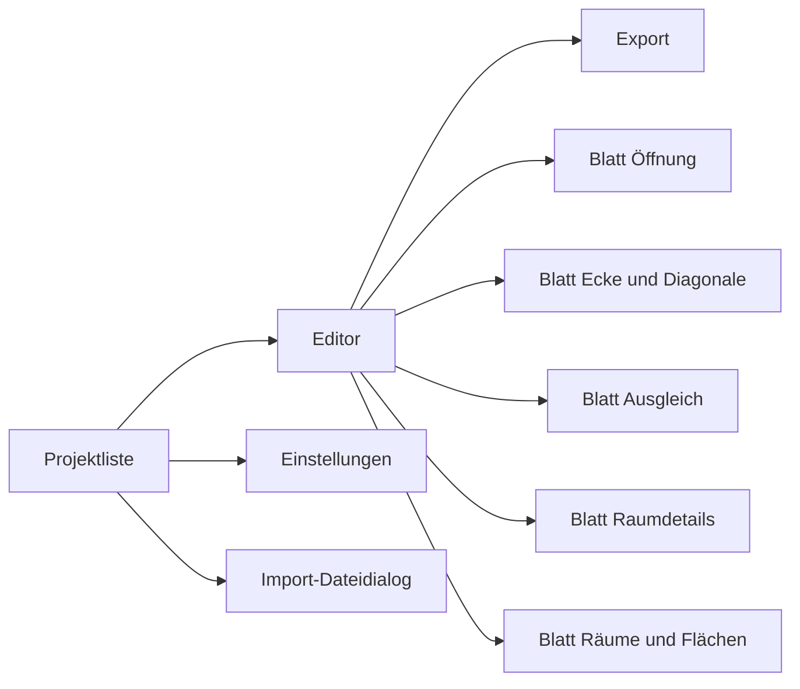

# PlanSnap – UX

## 1. Screens und Navigation



| Screen | Zweck | Leer | Laden | Fehler |
|---|---|---|---|---|
| Projektliste | Anlegen, Öffnen, Umbenennen, Duplizieren, Löschen, Import | Erklärung + „Neues Projekt“ | Skeleton | Meldung + erneut versuchen |
| Editor | Messen und Bearbeiten | „Erste Wand eingeben“ | Fortschritt | Projekt nicht ladbar, zurück zur Liste |
| Export | Format, Maßstab, Papier, Teilen oder Speichern | Hinweis „Noch kein Raum“ | Fortschritt | Meldung + erneut versuchen |
| Einstellungen | Einheit, Toleranz, Raster, Hinweise | – | – | Wert wird abgelehnt und erklärt |

## 2. Editor im Hochformat

```text
+--------------------------------+
| <  Wohnung Süd     ↶  ↷  ⋮     |
+--------------------------------+
|                                |
|      Live-Plan (ca. 50 %)      |
|      Pinch, Pan, Tippen        |
|                                |
| [Küche · 11,31 m² · ⚠ Vorschlag]|
+--------------------------------+
| Wand 4          345 cm   D 12  |
| Ecke: [ Links ] [ Rechts ] [∠] |
| [ 7 ] [ 8 ] [ 9 ]  [  ⌫  ]     |
| [ 4 ] [ 5 ] [ 6 ]  [  D  ]     |
| [ 1 ] [ 2 ] [ 3 ]  [ Diag ]    |
| [ , ] [ 0 ] [      OK      ]   |
+--------------------------------+
```

Alle Messaktionen liegen in der unteren Hälfte. Andere Geräteformen erhalten denselben Aufbau mit scrollbarem Eingabebereich. Ohne Optimierung für Querformat und Tablets bleiben sie bedienbar und verlieren keinen Zustand.

## 3. Messablauf

1. Neues Projekt legt automatisch den ersten Raum an.
2. Länge eintippen, `OK` bestätigt. Die Wand erscheint sofort im Plan.
3. Die Richtung der nächsten Wand ist die zuletzt gewählte (Start: links, 90°). Ein Tipp auf `Links` oder `Rechts` ändert sie.
4. `∠` öffnet die Winkeleingabe. `D` ändert die Wandstärke, vorbelegt mit dem letzten Wert.
5. `Schließen` erscheint ab 3 Wänden. Die App wertet den Raum aus:

| Ergebnis | Darstellung | Aktion |
|---|---|---|
| Exakt | Grüner Haken, Fläche | Weiter |
| Kleine Lücke | Lücke in cm und Vorschau | `Ausgleichen`, `Maße prüfen` |
| Formabweichung | Gestrichelter Umriss, „Form nicht bestätigt“ | Empfohlene Diagonale oder Winkel eintragen |
| Unmöglich | Rot markierte Maße, Erklärung | Maß ändern |

Ein Tipp auf eine Wand, Ecke oder Öffnung wählt sie aus und öffnet ihre Bearbeitung. Langes Drücken auf einen Raum startet das Verschieben. Änderungen laufen immer über Befehle und sind rückgängig machbar.

**Andocken (CR-W2-03):** Der Nutzer wählt eine Wand oder Öffnung des Wirtsraums und eine eigene Wand. Der Raum legt sich mit dieser Wand bündig an den Anfang der Wirtswand oder an den Beginn der Öffnung, immer auf die Außenseite des Wirts und im Abstand der Wirtswandstärke, unabhängig davon, in welcher Richtung beide Räume gemessen wurden. Der Versatz (Vorbelegung 0) verschiebt ihn entlang der Wirtswand in deren Laufrichtung (Messrichtung des Wirts, von `V_i` nach `V_{i+1}`). Eine Tür, die nicht breiter als die eigene Wand ist, liegt bei Versatz 0 vollständig vor ihr. Die Geometrie regelt DOMAIN §10.

## 4. Gesten

| Geste | Wirkung |
|---|---|
| Zwei Finger | Zoom und Verschieben der Ansicht |
| Ein Finger ziehen | Verschieben der Ansicht |
| Tippen | Auswahl |
| Lang drücken + ziehen | Raum verschieben, Einrasten aktiv |
| Doppeltippen | Plan einpassen |

Gesten ändern ohne Long-Press nie das Modell.

**Zoom (CR-W2-01):** Der Maßstab der Ansicht liegt zwischen `1e-4` und `100` px/mm (`ZoomLimits.DEFAULT`). Bei `1e-4` px/mm passt jeder gültige Raum (höchstens 128 Wände zu 100 m, also höchstens 6,4 km Ausdehnung) auf 640 px. Bei `100` px/mm ist die kürzeste Wand von 10 mm 1 000 px lang, ihre Ecken liegen also auch bei 4 px/dp weit mehr als ein Touch-Ziel von 48 dp auseinander. Zoomen hält den Punkt unter den Fingern fest. Doppeltippen passt den ganzen Plan ein und lässt dabei 24 dp Rand an jeder Seite. Ein leerer Plan ändert die Ansicht nicht.

**Treffen:** Ein Tipp trifft ein Element, wenn es höchstens 24 dp vom Finger entfernt ist, der halben Mindestgröße eines Touch-Ziels von 48 dp (§6). Der Radius bleibt auf dem Bildschirm bei jedem Zoom gleich. Bei mehreren Kandidaten gilt die Trefferpriorität aus DOMAIN §11.

## 5. Einmalige Hinweise

Höchstens ein Hinweis gleichzeitig, schließbar, in den Einstellungen zurücksetzbar: Ziffernblock, Richtung, Schließen, Diagonale bei einem Vorschlag, Ausgleich bei einer Lücke.

## 6. Design-Tokens

| Token | Hell | Dunkel |
|---|---|---|
| `primary` | `#1B5FAA` | `#A6C8FF` |
| `onPrimary` | `#FFFFFF` | `#003060` |
| `surface` | `#F8F9FC` | `#11141A` |
| `onSurface` | `#191C20` | `#E2E2E9` |
| `planWall` | `#1F2A37` | `#DCE3EC` |
| `planGrid` | `#DDE3EC` | `#2A313B` |
| `planDimension` | `#1B5FAA` | `#A6C8FF` |
| `warning` | `#8A5000` | `#FFB95C` |
| `error` | `#BA1A1A` | `#FFB4AB` |
| `success` | `#17693A` | `#7FDB9F` |

Kein Dynamic Color. Der Export nutzt immer die helle Planpalette. Abstände: 4, 8, 12, 16, 24 dp. Tasten des Ziffernblocks mindestens 56 dp, alle anderen Touch-Ziele mindestens 48 dp. Status wird nie nur über Farbe vermittelt, sondern immer zusätzlich über Symbol und Text.

## 7. Barrierefreiheit und Sprache

- Jede Taste und jedes Symbol hat ein TalkBack-Label.
- Der Plan bietet eine semantische Alternative: die Liste aus Räumen und Wänden mit Maßen und Status.
- Texte skalieren bis 200 %, der Eingabebereich scrollt dann.
- Alle Texte liegen in `strings.xml` (DE, EN), Pluralformen über `plurals`, Zahlen nach Gerätesprache. Kommaeingabe akzeptiert `,` und `.`.
- Kurze Haptik bei `OK`, deaktiviert sich mit der Systemeinstellung.
